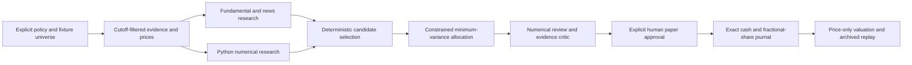

# Presenter notes

## Architecture

Python modular monolith; React/Vite frontend; local loopback JSON API; fixture/provider adapters; sequential checkpointed workflow. The implemented executor is a local state machine. LangGraph/FastAPI remain future options, not installed capabilities. No distributed worker or automatic scheduler is claimed.

## Likely questions

| Question | Answer |
| --- | --- |
| Is AI calculating portfolio weights? | No. Python calculates returns/covariance and solves minimum variance under explicit bounds. Selection rules are deterministic; the LLM supplies schema-validated cited findings. |
| Are sources reliable because citations validate? | Validation proves that a cited ID was supplied and eligible. It does not prove factual correctness or complete coverage. |
| Does multi-agent research beat one agent? | These fixtures show no extra selection benefit. The combined researcher uses one call per company plus the same critic; separate roles use two calls plus that critic. Actual model quality and cost are unmeasured. |
| Why include numerical-only and equal-weight controls? | They separate allocation mathematics from research selection. Candidate sets and common execution/costs remain visible. |
| Is the holdout genuinely unseen market data? | It is newly invented evaluation-only fixture data withheld from decision code. It is not an independently collected market test or a statistical performance claim. |
| Why are both five and twenty companies supported? | Five is the original regression proof; twenty checks configurable scaling and complete review within explicit limits. |
| What is stored? | Policies, model/prompt identities, hashes, evidence, structured reports, concise rationales, tool events and exact journal/valuation inputs. Hidden model reasoning is not stored. |
| What happens when constraints fail? | Structured infeasible/validation outcomes are returned; constraints are not relaxed. Numerical rounding is reconciled inside the optimiser before strict ledger checks. |
| Does reload trigger AI or trades? | No. Reload reads saved data. Research, retry, approval and valuation updates have explicit controls. There is no brokerage execution. |
| Does this track realistic total returns? | No dividends, taxes, real fills, calendar validation or rebalancing are implemented. Corporate actions reject; costs/slippage conventions are declared. |
| How much does it cost? | This fixture execution makes zero provider calls and adds no provider spend. Reserved output tokens are caps. Actual live inference tokens/cost and current free quotas are unknown. Installation needs locally cached packages or internet access. |

## Evidence boundaries

Prior narrow live proofs recorded in [task history](../docs/history/2026-10-24/tasks.md) and [change history](../docs/history/2026-10-24/changes.md) include SEC facts, ten IEX daily bars, two MSFT sources and one Gemini schema/research proof. They do not establish live coverage for twenty companies or today's account entitlements. No live calls are needed or planned during this demo. The distributable includes permitted code/configuration, synthetic fixtures and recorded synthetic evidence; it excludes credentials, raw live caches and existing user/runtime books.

Current evidence: regression tests; browser checks of success, evidence, approval/reload, replay and fixture failure recovery; hash-verified comparison replay; measured local scaling samples. Review the current m5_3_verification.json for exactly what was rerun. Future evaluation needs richer independent evidence, time-aware prices and predefined held-out experiments before quality or performance claims.
