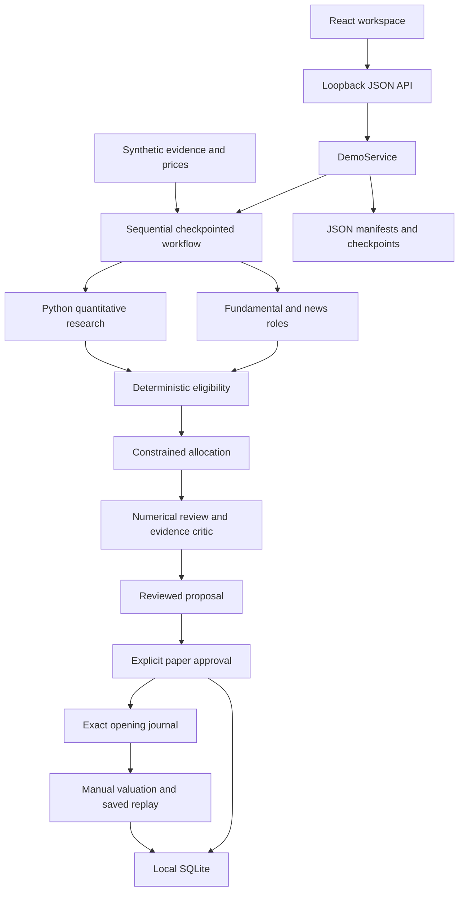

# Architecture

## Runtime and dependency direction

Agent of Odds is a Python modular monolith with a React/Vite frontend. `backend.app.ui` runs the standard-library, single-threaded HTTP server on loopback. `DemoService` coordinates the fixture workflow, paper service and monitoring service. The browser advances one stage per explicit request; there is no deployed worker or scheduler.

The dependency direction is presentation → application orchestration → domain calculations and injected contracts/adapters. Numerical finance can run in tests and offline experiments without a web server or LLM. Research roles consume filtered evidence and an injected `generate_json` client. External access is implemented through bounded provider adapters. Domain modules do not import provider SDKs.

## Source ownership

| Source | Responsibility |
| --- | --- |
| [ui.py](../../backend/app/ui.py) | HTTP validation, route dispatch and compiled-asset serving |
| [application/](../../backend/app/application) | Fixture input construction, report projection, selection, approval and monitoring |
| [domain/](../../backend/app/domain) | Policies, prices, returns/statistics, optimiser, exact journal and valuation |
| [contracts/market_data.py](../../backend/app/contracts/market_data.py) | Daily-close and timestamp primitives |
| [adapters/data/](../../backend/app/adapters/data) | Fixture, SEC, Alpaca and allowlisted evidence access |
| [adapters/llm_gemini.py](../../backend/app/adapters/llm_gemini.py) | Bounded Gemini REST transport and safe response diagnostics |
| [retrieval/index.py](../../backend/app/retrieval/index.py) | Versioned evidence records, deterministic chunks and lexical retrieval |
| [research/](../../backend/app/research) | Fundamental/news/quantitative reports and combined-research experiment |
| [workflows/](../../backend/app/workflows) | Sequential stages, persistent budgets, fixed-type checkpoints and review |
| [evaluation/](../../backend/app/evaluation) | Single-period evaluation, controlled comparisons and archived replay |
| [config/](../../config) and [fixtures/](../../fixtures) | Explicit proof configuration and labelled synthetic inputs |
| [frontend/src/](../../frontend/src) | Controlled React interaction and presentation primitives |
| [backend/tests/](../../backend/tests) | Offline domain, contract, workflow, HTTP and packaging verification |

Entry points also include `backend.app` for fixture prices, `universe_audit`, `compare_experiments`, `demo_bundle` and explicit provider/research probes. Run procedures belong to [runbooks](../runbooks/README.md).

## Actual stack and boundaries

[pyproject.toml](../../pyproject.toml) declares Python `>=3.14,<3.15` and NumPy; uv manages the lock and environment. [frontend/package.json](../../frontend/package.json) declares React, React DOM, Vite, its React plugin and Prettier. npm with `package-lock.json` is the exercised frontend installation path; a checked-in pnpm lock is not a second installation contract.

The executor is a local state machine, retrieval is TF-IDF cosine over a JSON index, schemas are Python dataclasses/explicit validators, and persistence is JSON plus SQLite. FastAPI, LangGraph, PostgreSQL, Chroma, Sentence Transformers, pandas, CVXPY and hosted tracing are not installed runtime capabilities. No empty service/repository layer is needed merely to match an earlier diagram.

Storage and entity contracts belong to [data and persistence](03-data-and-persistence.md); financial algorithms belong to [allocation and simulation](05-allocation-and-simulation.md). Adding a framework or distributed process must preserve those boundaries and follow the platform change process.
